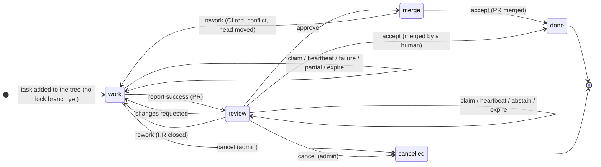

# afe-fleet: coordination design

One binary, `afe-fleet`, with three roles: `afe-fleet worker`, `afe-fleet admin`, `afe-fleet server`.
The formal model is in [`design-lean/TaskMachine.lean`](design-lean/TaskMachine.lean); it type-checks with `lean TaskMachine.lean` from `docs/design-lean/` (Lean 4.35, core only, no `sorry`). [`design-lean/GitBackendTest.lean`](design-lean/GitBackendTest.lean) runs every transition and every denied update against a real git remote.

## 1. The whole design in one paragraph

Every task has one small JSON document, `status.json`, and the only thing a coordination backend must provide is **compare-and-swap on that document**.
On GitHub the document is the tip of the task's lock branch, `task-lock/<task-id>`, and CAS is a fast-forward push.
On the server it is a row with a `rev` column and CAS is `UPDATE … WHERE rev = ?`.
Workers and the admin never talk to each other; each one reads a status, computes the next status with one pure function (`step`, 40 lines, specified in Lean), and tries to CAS it in.
A rejected CAS means someone else moved first: re-read and decide again.
There is no `failed` state. A failed attempt releases the lease and leaves the task claimable with more information than it had before.

## 2. Task state machine

A status is "what the task needs next" plus an optional lease.



| Field | Meaning |
|---|---|
| `need` | `work`, `review`, `merge`, `done` or `cancelled` |
| `epoch` | Fencing token. Every claim bumps it. It never decreases. |
| `lease` | Current holder, or null. Only `work` and `review` can be leased. |
| `pr` | Latest PR. Survives failed attempts, so the next worker resumes from it. |
| `author` | Who produced the PR under review. A reviewer must be someone else. |
| `strikes` | Leases that ended without progress. Used only for backoff and escalation. |

| Event | Who | Guard | Effect |
|---|---|---|---|
| `claim(w, e)` | worker | no lease, `epoch = e`, `need` is `work`, or `review` and `w ≠ author` | `lease := w`, `epoch := e+1` |
| `heartbeat(w, e)` | worker | holds lease with token `e` | none (rejection means "you were fenced") |
| `report(w, e, success pr)` | worker | holds lease, `need = work` | `need := review`, `pr`, `author := w`, lease released |
| `report(w, e, partial pr)` | worker | same | `pr` recorded (draft), stays `work`, lease released |
| `report(w, e, failure)` | worker | same | `strikes += 1`, lease released |
| `review(w, e, approve)` | worker | holds lease, `need = review` | `need := merge`, lease released |
| `review(w, e, changes)` | worker | same | `need := work`, lease released |
| `review(w, e, abstain)` | worker | same | lease released |
| `expire(e)` | admin | leased, `epoch = e` | `strikes += 1`, lease released |
| `accept` | admin | `need` is `review` or `merge` | `need := done` |
| `rework` | admin | `need` is `review` or `merge` | `need := work`, lease released |
| `cancel` | admin | `need` is `work` or `review`, leased or not | `need := cancelled`, lease released (the holder's next heartbeat fails) |

### What is proved

| Guarantee | Theorem |
|---|---|
| The invariant holds in every reachable state | `reachable_wf` |
| Once a lease is expired, its old holder can never heartbeat, report or review again, whatever happens later | `zombie_fenced` |
| Two workers racing to claim the same task: at most one wins | `claim_exclusive` |
| Delivering any event twice is rejected or a no-op, so every request may be retried blindly | `retry_safe` |
| A failed or expired attempt changes nothing but the lease and the strike count | `failure_harmless`, `expire_harmless` |
| An unleased task needing work is claimable by anyone, whatever its history | `work_always_claimable` |
| Only a reviewer's "changes" or the admin's "rework" can move a task backwards; failures cannot | `regress_only_by_verdict` |
| Cancelling a task fences its lease holder: its heartbeat, report and review are rejected from then on | `cancel_fenced` |
| From every state except `cancelled` there is a continuation through the normal path that reaches `done` | `no_dead_end` |
| Every task that is not `done` or `cancelled` has an enabled event; any lease can be released | `never_stuck`, `lease_always_releasable` |
| `done` and `cancelled` are final | `terminal_final`, `done_final` |
| A write decided on a stale read is rejected | `Log.stale_rejected` |
| A write that succeeds is a legal step of the current state, not of the stale one | `Log.submit_is_step` |
| Racing writers on one snapshot: one wins | `Log.one_winner` |
| Every history either backend can produce is a legal run of the state machine | `Log.run_reachable`, `Log.run_wf` |

**Safety never depends on a clock.** `expire` is an event; when the admin fires it is policy.
Firing it on a slow but living worker wastes that worker's effort and nothing else, because the epoch fences it (`zombie_fenced`).

**What is not proved, and cannot be:** that an agent ever succeeds. The model guarantees no state is a dead end and no failure costs progress. Liveness needs one assumption: attempts on a task succeed infinitely often. Section 7 says what happens when that assumption fails for a particular task.

## 3. `status.json`

```json
{
  "v": 1,
  "task": "zlib/inflate",
  "need": "work",
  "epoch": 3,
  "lease": {
    "worker": "alice/box1-2", "gh_user": "alice", "nonce": "9f2c61d0",
    "spec_rev": "c0ffee1…", "spec": "5d0a…", "claimed_at": "2026-11-13T12:00:00Z", "heartbeat_at": "2026-11-13T12:35:00Z",
    "note": "lake build running; 3 commits; 412k tokens",
    "checkpoint": {"repo": "alice/project", "ref": "task/zlib/inflate/e3", "sha": "4b1e…"}
  },
  "pr": {"repo": "org/project", "number": 42, "head_sha": "77ac…", "draft": true, "spec": "5d0a…"},
  "author": null,
  "strikes": 2,
  "rounds": 0,
  "last": {
    "epoch": 2, "worker": "bob/gpu-1", "outcome": "partial",
    "summary": "Proved 3 of 5 lemmas; inflate_fast blocked on a missing bound.",
    "progress": "see PR #42 and NOTES.md on the branch",
    "debug": {"kind": "task", "detail": "verify: lake build failed in Inflate/Fast.lean:212", "log": "refs/attempt-logs/zlib/inflate/e2"},
    "at": "2026-11-13T11:40:00Z"
  }
}
```

- `last.outcome` is `success`, `partial` or `failure` for work leases, and `approve`, `changes`, `abstain`, `expired` or `rework` otherwise. `success` and `partial` always carry `pr`; `partial` and `failure` always carry `debug` and `progress`.
- Timestamps are informational. No decision compares a timestamp written by one machine against another machine's clock.
- `spec_rev` is the config-repo commit the attempt read its task and project files from. `spec` is the task's content hash at that commit (section 5, "Where decisions come from"); `pr.spec` is the one the PR was written against.
- `nonce` distinguishes two processes that share a worker id (a restarted worker must not silently inherit the old process's lease).
- Keep it under about 8 KB. Full transcripts go to a separate ref or URL named in `debug.log`, after secret redaction.
- History is the commit chain of the branch (GitHub) or the `events` table (server). On GitHub it stays reachable through the `archive` branch after the lock branch is deleted (section 4).

## 4. Mapping to the two backends

Both backends implement three calls. Worker and admin code is written once against them.

```
snapshot()                 -> { task_id: (rev, status) }
submit(task, rev, event)   -> Won(rev') | Lost(current status) | Unknown
changes(since)             -> events after a cursor
```

`Unknown` (timeout, connection reset, 5xx) is resolved the same way everywhere: read the task again. If the tip is what you tried to write, you won. If it is still `rev`, nothing was applied, so retry. Otherwise you lost.

| | GitHub | Server |
|---|---|---|
| Storage | Lock branch `task-lock/<task-id>` in the lock repo; its tree is exactly one file, `status.json` | `tasks(id, rev, status)` and `events(seq, task, rev, event, at)` in SQLite |
| `rev` | Tip commit SHA | Integer |
| `snapshot()` | `git fetch lock '+refs/heads/task-lock/*:refs/remotes/lock/*'`, then `git cat-file --batch`. One round trip, incremental, not counted against the REST rate limit. | `GET /tasks` |
| `submit` | Build a commit with parent = `rev` using plumbing (`hash-object`, `mktree`, `commit-tree`), then `git push --force-with-lease=<ref>:<rev> lock <commit>:<ref>`, where `<ref>` is `refs/heads/task-lock/<task-id>` | See endpoints below; the server runs `step` inside one transaction |
| `Lost` | Push rejected (stale info, non-fast-forward, "reference already exists") | HTTP 409 with the current status |
| `changes()` | `git ls-remote lock 'refs/heads/task-lock/*'` every 20 s, diff against the last map, walk `old..new` on changed lock branches. Each commit is one event, so nothing is missed after downtime. | `GET /admin/events?after=<seq>` (long-poll) |
| Who runs `step` | The client; the admin audits every new commit and repairs illegal ones | The server; illegal events get 409 |
| Lease expiry | Admin: "tip unchanged for TTL across my own successful polls" | Same rule, same code |
| Publish a task | Nothing to do: a task in the tree with no lock branch is unclaimed, and its first claim creates the branch (create-only push, empty expected value) | `PUT /admin/tasks` |

Event to operation:

| Event | GitHub | Server |
|---|---|---|
| `claim` | push commit "claim" | `POST /worker/task-claim` `{worker, gh_user, nonce, kinds, filter}` → `{task, epoch, rev, status}` or 204. The server picks a random claimable task. A retry with the same nonce returns the same lease. |
| `heartbeat`, `report`, `review` | push commit | `POST /worker/task-update` `{task, epoch, nonce, kind, outcome?, verdict?, pr?, payload}` → 200, or 409 meaning stop now |
| `accept` | push commit | `POST /admin/task-accepted` `{task, pr, merged_sha}` |
| `rework` | push commit | `POST /admin/task-rework` `{task, reason, detail}` (not in your list) |
| `expire` | push commit | `POST /admin/task-expire` `{task, epoch}` (not in your list) |
| `cancel` | push commit, then a `cancelled/<task-id>.json` record and branch deletion | `POST /admin/task-cancelled` `{task}`; removing a task from the tree also cancels it |

### GitHub specifics

- **One ref per task.** The lock branch `task-lock/<task-id>` (full name `refs/heads/task-lock/<task-id>`) is the only coordination ref a task has. Its tip is both the lock and the status. There is no separate `refs/lock/<task-id>`: a second ref would need a second write, and there would be a window where the two disagree.
- Task ids are tree paths. Only leaves are tasks, so `task-lock/a` and `task-lock/a/b` never both exist (git cannot store both).
- **No lock branch means nobody has claimed the task yet.** It reads as the initial status (`need = work`, epoch 0, no lease). The first claim creates the branch with `--force-with-lease=<ref>:` (empty expected value = create only), so workers start tasks without any admin step. If several workers create it at once, git accepts exactly one; the others see "stale info" or "reference already exists" and treat it as `Lost`, not as an error (the reference project once misread the latter as an outage).
- **The branch lives from the first claim until the task is accepted**, also between leases, because it holds the PR, strikes and epoch. Once the admin has merged the PR and committed `accept`, it records the task as done in the config repo and deletes the branch. So `fleet-coord` holds one branch per task that is in progress or waiting for review or merge, not one per task ever done:

  | Task is | Lock branch | Record of it |
  |---|---|---|
  | never claimed | none | the task in the config tree |
  | claimed, in progress, partial, in review, awaiting merge | `task-lock/<task-id>`; `lease` set while someone works on it | `status.json` at the branch tip |
  | accepted | deleted after a grace period | `done/<task-id>.json` in the config repo, plus the `archive` branch |
  | cancelled | deleted after a grace period (at once if the task left the tree) | `cancelled/<task-id>.json`, plus the `archive` branch |

  A cancelled task is never claimed again, but unlike a done one it does not satisfy other tasks' dependencies. The post-claim re-check below looks for either record.

- **Retiring a branch**, in this order, each step idempotent:
  1. `accept` is committed on the lock branch (`need = done`; no further event is legal, `done_final`).
  2. The admin commits `done/<task-id>.json` to the config repo: the final `status.json` plus the lock tip SHA. This file is the durable "done" record. It lives outside the task's directory, so it does not change the task's `spec`.
  3. The admin adds a commit to the single `archive` branch of `fleet-coord` whose second parent is the lock tip, so the task's full history stays reachable after its branch is gone.
  4. After a grace period (default 1 hour from step 2), the admin deletes the lock branch. The admin bypasses the deletion rule; workers still cannot delete.
- **Done means `done/<task-id>.json` exists.** Without it, a deleted branch would look like a task nobody has claimed. A worker could have fetched the config repo before the done record was written, and its claim could land after the branch was deleted. So the worker checks twice:
  1. Before claiming it skips tasks with a done record. This is only a filter that avoids wasted claims.
  2. **After a claim that created the branch** it fetches the config repo again and looks for the done record. This check is the guarantee. A claim can create the branch only while it is absent, and for a done task the branch is absent only after the admin deleted it, which happens only after the done record was committed. The second fetch starts after the claim landed, so it sees the record. No clock or timing assumption is involved.

  The check needs a linearizable read: a `git fetch` of the config repo's branch tip. `raw.githubusercontent.com` and the contents API can serve content that is minutes old and must not be used. I believe GitHub's git endpoints are linearizable (a push is acknowledged once its replicas agree) but have not verified it.

  When the re-check finds a done record, the worker stops without further writes. The branch stays leased to it, nobody else claims it (the record makes it ineligible), and the admin's next sweep deletes it. A worker that crashes between the claim and the re-check is cleaned up the same way.

  The grace period before deletion is only for efficiency: while the branch still exists with `need = done`, a late claim is rejected by `step`, so workers that read the config just before the record landed do not recreate the branch only to back off.
- **Every write must use `--force-with-lease`; plain fast-forward pushes are not safe once branches are deleted.** A zombie that holds a commit from before the deletion would *recreate* the branch with a plain push, because there is nothing for it to fast-forward over. With `--force-with-lease=<ref>:<old tip>` the push is rejected as "stale info", because the ref no longer exists. (Checked against a local bare repository: the plain push created the branch, the lease push was rejected.) The git test still exercises both modes. Only the lease mode is used by the design.
- In the formal model, a missing branch is the empty log (`Log.Run.init`, revision 0), and one branch's life is one `Log.Run` ending in `done`, so the proofs are unchanged. Deletion and the done record are outside the per-task model; the done record is what keeps a task's life from starting again.
- A lock branch whose name is not a task in the tree is ignored by workers. The admin deletes it (it bypasses the deletion rule).
- **The lock repo is a repository of its own** (`autoformalize-everything/fleet-coord`), separate from the config repo (`fleet.toml` and the task tree) and from the code repos. It holds nothing but a default branch with a README, the lock branches, and the access-request issues. Workers get push access to it and nothing else; code changes go through forks and PRs.
- Its rulesets (section 6 has the reasons). The first two are configured on `fleet-coord`; the last two are recommended and not configured yet:

  | Ruleset | Targets | Rules | Bypass | On `fleet-coord` |
  |---|---|---|---|---|
  | lock branches | `refs/heads/task-lock/**/*` | restrict deletion, block non-fast-forward (creation allowed: it is the first claim) | admin, maintain | "no ff" (27205435) |
  | default and archive branches | `~DEFAULT_BRANCH`, `refs/heads/archive` | restrict deletion, restrict updates, block non-fast-forward | admin, maintain | "protecc master" (27205300) |
  | other branches | all branches except those above | restrict creation | admin, maintain | not configured |
  | tags | all tags | restrict creation | admin, maintain | not configured |

  The last two only stop the repo being used for unrelated storage; workers ignore other branches and tags, so nothing depends on them.

  GitHub Actions is disabled on the repo. The admin runs as an admin of the repo; workers are never given maintain, because maintain bypasses the rules.
- Trust model: anyone with push access to the lock repo can write any status. This mode is cooperative. The merge itself does not trust `status.json`; see section 6.

## 5. Worker

```
loop:
  recover()        finish or abandon what the journal says was in flight; remove stray containers
  maintain()       config / binary / unit update (only here, never mid-attempt); preflight
  snapshot()       fetch the config repo, then the lock branches
                   candidates = in the tree ∧ unleased ∧ need ∈ my kinds ∧ claimable ∧ deps done ∧ filter ∧ cooldown over
  submit(claim)    CAS against the lock tip the decision was made on; records spec_rev and spec
                   if the claim created the branch: fetch the config repo again; done record → stop (section 4)
                   Lost → pick another immediately; nothing claimable → idle backoff 30 s … 15 min
  run attempt      journal, workspace, heartbeat thread, agent supervisor
  finish           verify → push → PR or review → submit(report) → cleanup
```

**Where decisions come from.** A claim is safe only if everything it was decided on is either checked by the CAS or cannot go stale in a harmful way:

| Input | Read from | If it is stale |
|---|---|---|
| `need`, `lease`, `epoch`, `author`, `strikes` | the task's lock branch, in the same read whose tip the CAS expects | The CAS rejects the claim (`Log.stale_rejected`; the git test pushes 190 such stale writes and all are rejected) |
| Dependencies done | `done/<task-id>.json` in the config repo | Harmless: only the admin writes done records and never removes them, so a stale read can only say "not done yet" |
| The task is not done | `done/<task-id>.json` in the config repo | Re-checked after a claim that created the branch; exact, see "Retiring a branch" in section 4 |
| The task exists, its `TASK.md`, `task.toml`, `project.toml` | the config repo | Not covered by the CAS. Handled by `spec` (below) |
| `STATUS.md` in the config repo | derived by the admin | Never an input. It is a summary for humans |

The report that ends a lease and the status change it causes are one commit, and the admin never clears a lease except by an `expire` commit on the same branch. So a worker cannot claim on the strength of a status the admin has since changed: whichever write lands second was based on the old tip and is rejected.

The config repo is the one input outside that CAS. A human can edit or delete a task between a worker reading the tree and the worker's claim landing. To bound that:

- `spec` is the content hash of what defines the task: the git tree hash of its directory plus the blob hash of the `project.toml` it inherits. The worker fetches the config repo immediately before claiming and writes `spec_rev` and `spec` into the claim commit.
- The admin compares every lease's `spec` with the current tree on each sweep. If it differs, it expires the lease (reason `spec-changed`). If the task is gone, it deletes the lock branch, which also fences the holder (its next push expects a tip that no longer exists).
- For `need = review` or `merge`, the admin compares `pr.spec`. If the task changed after the PR was written, it sends the task back with `rework`.
- So a lease on a stale definition lives at most one admin sweep, and after that every write it makes is rejected (`zombie_fenced`). The wasted work is bounded by the sweep interval plus one heartbeat.

A stronger version would make the claim itself carry `spec` and reject a mismatch in `step`. That needs the current `spec` on the lock branch before anyone claims, which brings back admin pre-created branches plus an admin commit on every affected branch for each tree change. For a bounded few minutes of wasted work, I don't think that is worth it.

**Selection** is random within a priority order: review, fix after "changes", continue a partial, new work. Random choice makes collisions rare; CAS makes them harmless.

**Attempt journal.** `~/.local/share/afe-fleet/fleets/<fleet>/journal-<slot>.json`, written atomically before each side effect:
`claimed → prepared → agent_started(session_id) → agent_finished → pushed(sha) → pr(number) → reported`.
On start the worker reads it and asks the backend whether the lease is still its own (same worker, epoch and nonce).

| Journal says | Lease still mine | Lease lost |
|---|---|---|
| `claimed`, `prepared` | continue | discard |
| `agent_started` | kill the stray container, restart the agent with `--resume <session_id>` in the same workspace; if resume fails, start fresh in the same workspace | push a checkpoint to my own branch, discard |
| `agent_finished`, `pushed`, `pr` | continue from that step; every step is idempotent | if the task is still unleased, re-claim and report; else leave the PR for the admin to close |

**Every external side effect has a deterministic key and is read back before retry.**
Work branch name `task/<task-id>/e<epoch>`; PR found by head branch before creating; review comments carry `<!-- afe-fleet task=… epoch=… sha=… -->`.

**Where the agent runs.** For now, directly on the worker's machine, as the worker's user, with the user's `HOME`: the agent CLI uses the operator's normal login (`claude auth login`, or `CLAUDE_CODE_OAUTH_TOKEN` from `claude setup-token`). Running in containers is deferred; the `docker` runtime in `agent.py` is kept but not used. What this costs:

- The agent can do anything the user can, including reading the worker's GitHub credential. Use a dedicated machine or user account for workers.
- There is no network restriction and no resource limit per agent. Killing an agent kills its process group; children that leave the group (daemons, `setsid`) can survive it.

**Checkouts: one shared clone per repository, one worktree per attempt.**

```
~/.local/share/afe-fleet/repos/<repo>-<hash>.git    bare clone, remote origin, refs/remotes/origin/*
~/.local/share/afe-fleet/repos/<repo>-<hash>.lock   flock(2), exclusive
~/.local/share/afe-fleet/fleets/<fleet>/attempts/<task>-e<epoch>/
    work/   git worktree of the shared clone, on local branch afe/<fleet>/<task>/e<epoch>
    task/   TASK.md, task.json        out/   result.json or review.json
```

- Everything afe-fleet keeps on a machine is under `~/.local/share/afe-fleet/` (`$AFE_FLEET_HOME` overrides it): `repos/` (shared clones), `mirrors/` (config-repo mirrors), and `fleets/<fleet>/` (lock-repo mirrors, journals, attempts with their worktrees, the server database). Only the per-host config stays in `~/.config/afe-fleet/<fleet>.toml`, and systemd units in `~/.config/systemd/user/`. Nothing goes in `~/.cache`: a worktree's commits are stored in the shared clone's object store, so treating it as a cache would lose unpushed work.
- Every slot of every afe-fleet process on the machine, in any fleet, shares the clone for a given URL: one fetch serves them all and a new attempt costs a worktree, not a clone.
- Fetching, adding and removing worktrees, and deleting branches and refs hold the file lock, which works across threads and processes. Work inside a worktree takes no lock: each has its own index, HEAD and branch.
- Local branches and temporary refs (`refs/afe/<fleet>/<task>/e<epoch>/prev` for the previous PR, `.../pr` for a review) are namespaced per attempt and removed with the worktree. The branch pushed for the PR is `task/<task-id>/e<epoch>` regardless of the local name.
- Automatic `gc` and maintenance are off in the shared clone: repacking under agents committing in other worktrees is the main way to corrupt it. A crashed attempt leaves a directory behind; the next `worktree add` prunes it.
- Agents can see each other's worktrees through `git worktree list` and could damage the shared clone; that is accepted on a dedicated machine.

- Agent contract: read `TASK.md` and `task.json` from the task directory named in the prompt; work in the worktree (the current directory); commit; write `result.json` in the output directory named in the prompt (`outcome`, `summary`, `progress`, `debug`, `followups[]`) or `/out/review.json` (`verdict`, `summary`, `comments[]`).

**Agent supervisor.** The worker owns the JSONL pipe.

- Send the prompt on stdin as a `user` message. Never pass it in argv (Linux rejects a single argument over 128 KiB).
- Every stdout line is appended to `transcript.jsonl` and counts as liveness. Non-JSON lines are logged, not fatal.
- Record `session_id` from the `system/init` line in the journal.
- On a `result` line, run the project's `verify` command in the container. If it fails and repairs remain (default 2), send the log back as the next `user` message. The agent's own claim of success is never trusted.
- Soft deadline: send "commit, write result.json, stop". Hard deadline five minutes later: `docker kill`.
- Stall (no output for `stall` minutes): kill, resume once, then give up.
- Set `BASH_DEFAULT_TIMEOUT_MS` and `BASH_MAX_TIMEOUT_MS` to the time remaining so a tool call cannot outlive the attempt.
- Killing the container kills the whole process tree, which replaces the process-group and subreaper machinery the reference project needed.

**Outcome is decided by the worker, not the agent.**

| Agent ended | Verify | Diff vs base | Report |
|---|---|---|---|
| normally | pass | non-empty | `success`, PR ready for review |
| any way | fail or timeout | non-empty | `partial`, draft PR, debug = verify log tail |
| any way | — | empty | `failure`, debug = last error and transcript ref |
| 429/5xx/529 before any tool use, OOM, docker error | — | — | `failure` with `debug.kind = "infra"`; if a diff exists, `partial` |
| 401/403 from the model API | — | — | `failure` (infra), then the worker stops claiming and reports itself unhealthy |

**Heartbeat.** A separate thread, every 5 minutes (TTL 20 minutes):

1. Snapshot the workspace with a temporary index (`GIT_INDEX_FILE`), so the agent's own index and HEAD are untouched, and push it to the work branch `task/<task-id>/e<epoch>` on the worker's fork.
2. `submit(heartbeat)` with a one-line note and the checkpoint SHA.

Heartbeat failures come in two kinds, and the worker treats them differently:

| Failure | Raised as | Examples | Worker |
|---|---|---|---|
| Lease failure | `Fenced` | the lock branch moved (expired, cancelled, taken over), the branch was deleted, the server answers 409 | kill the container at once and stop; no report |
| Connectivity failure | `Unreachable` | `git push`/`ls-remote` fail, the server cannot be reached or answers 5xx; whether the write landed is unknown | keep working, retry the heartbeat sooner, log how long it has been unreachable |

The final update (report or review) retries `Unreachable` with exponential backoff (5 s doubling to 5 minutes, for up to an hour). Every retry is idempotent: on GitHub it re-pushes the *same* commit, so a push whose reply was lost reads back as success; on the server it re-sends the same request id, and the server replays its first answer. Only `Fenced` ends the attempt without a report. The heartbeat thread and the report are serialized per lease, so a heartbeat landing just before the report cannot make the report look like a lost lease.
Because the checkpoint is pushed before the heartbeat, a host that dies loses at most five minutes of work and the next claimant starts from that branch.

**Work across workers.** A continuation by the same GitHub user pushes to the same PR branch with `--force-with-lease=<branch>:<observed head>`. A different user branches from the previous head, opens a new PR, and the report replaces `pr`; the admin closes the superseded one.

**Review.** Claim a `review` task, check out `pr.head_sha` read-only, run the agent with the review prompt, post one PR review bound to that SHA, then `submit(review verdict)` carrying `reviewed_sha`. "Changes requested" is the comment on the PR plus the task returning to `work`; the next author gets the review as input. Work outside the task's scope goes in `followups[]`, which the admin files as new tasks.

**Shutdown.** On SIGTERM: interrupt the agent, checkpoint, report `partial` (reason `worker-shutdown`). The lease is released immediately instead of waiting for the TTL.

### Configuration, service, self-update

`afe-fleet worker run org/repo` fetches `fleet.toml` from the repo's default branch; `afe-fleet worker run ./fleet.toml` uses a file. Host-local settings (worker id, filter, slots, credentials, time limits) live in `~/.config/afe-fleet/<fleet>.toml`.

`fleet.toml` holds only what coordination needs:

```toml
[fleet]
name = "autoformalize-everything"   # service name; unique per host
version = "0.3.1"                   # workers converge on this
min_version = "0.3.0"               # older workers refuse to claim
sha256.x86_64-linux = "…"

[coord]
mode = "github"                     # or "server"; exactly one
lock_repo = "autoformalize-everything/fleet-coord"   # lock branches only
tasks_repo = "org/fleet-config"     # the task tree; this file usually lives here too
# url = "https://coord.example.org"

[lease]
heartbeat = "5m"
ttl = "20m"

[access]                            # GitHub mode; section 6
write_request = "auto"              # "auto" | "approve" | "off"
deny = []                           # logins never granted
```

Everything about the code being worked on is outside the coordination design and lives in the task tree. A `project.toml` in any directory above a task describes its project; the nearest one wins.

```
tasks/
  zlib/
    project.toml      # repo, base, image, verify
    inflate/
      TASK.md
      task.toml       # deps, tags
```

```toml
repo = "org/zlib-lean"
base = "main"
image = "ghcr.io/org/zlib-agent@sha256:…"
verify = ["lake", "build"]
```

- Coordination never reads `project.toml`. The worker resolves it after claiming, at the `spec_rev` it records in the lease; `status.json` carries the resulting `pr.repo`.
- One fleet can therefore serve many code repos and images, and a worker's filter can select by subtree.
- A task with no `project.toml` above it is not claimable, and workers skip it.
- The service-name key is `[fleet] name`, because "project" means a code project in the tree. The service is unique per fleet config.

Service and updates:

- `afe-fleet worker install <repo|toml>` writes `~/.config/systemd/user/afe-fleet-worker-<fleet>.service` (`Restart=always`, `TimeoutStopSec=180`), enables it, and runs `loginctl enable-linger` so it survives logout.
- One process runs N slots. That gives one snapshot fetch, one updater and one circuit breaker per host.
- Between attempts the worker re-reads `fleet.toml`. If the version, the rendered unit file or the config hash differ: download, check SHA-256, run `new --self-test`, rename into place, rewrite the unit, `daemon-reload`, exit 0. systemd starts the new binary.
- The previous binary is kept. If the new one fails three starts before its first successful snapshot, an `ExecStartPre` guard restores it.
- `status.json` carries `v`. A worker that sees a `v` it does not know stops claiming and updates.

## 6. Admin

A stateless, level-triggered reconciler. Every sweep derives what to do from what it observes, so a crash at any point is repaired by the next sweep. Two admins can run at once: every write is a CAS and merging is idempotent.

| Observed | Action |
|---|---|
| Lock branch for a task id that is not in the tree | `cancel` (fences a holder), archive, delete |
| `need = cancelled`, no `cancelled/<task-id>.json` | write it, archive; delete the branch after the grace period |
| `afe-fleet admin cancel <task> [--remove]` | `cancel`, record it, and with `--remove` delete `tasks/<task-id>/` from the tree |
| Leased, tip unchanged for TTL across my own successful polls | `expire` |
| Leased, and the lease's `spec` differs from the task's current content hash | `expire` (reason `spec-changed`) |
| `need` is `review` or `merge`, and `pr.spec` differs from the current content hash | `rework` (reason `spec-changed`) |
| `need = merge`, PR head = `reviewed_sha`, required checks green, mergeable | merge with the API's `sha` guard, then `accept` |
| `need = merge`, PR already merged | `accept` (crash between merge and accept, or a human merged) |
| `need = done`, no `done/<task-id>.json` | write it, then add the lock tip to the `archive` branch |
| `need = done`, done record older than the grace period | delete the lock branch |
| Lock branch for a task that has a done record, `need ≠ done` | delete it (a claim from a stale tree; its worker has already stopped, or crashed before checking) |
| `need = merge`, checks red, conflict, or head moved | `rework` with the reason and log excerpt |
| `need = merge`, checks pending | wait; after the CI timeout, `rework` |
| `need = review`, PR closed unmerged | `rework` |
| `strikes` or `rounds` over threshold | label for a human (section 7) |
| New commit on a lock branch that is not a legal `step` from its parent | push a repair commit restoring the last legal status |
| Open PR not referenced by any status for over an hour | close as superseded |
| Anything changed | regenerate `STATUS.md` in the config repo, one commit per sweep. A summary for humans; no worker reads it |
| Open issue in the lock repo with `write-request` in the title | grant its creator write access (below) |

- The merge does not trust `status.json` alone. It also requires what GitHub itself authenticates: the PR exists, its head is the reviewed SHA, and CI is green on that SHA.
- After a polling gap longer than one heartbeat interval (admin restart, GitHub outage), all TTL timers restart. Otherwise an outage would expire every lease at once.
- If a project's base branch goes red after a merge, the admin stops merging into that project and adds a top-priority `fix-main` task under it in the tree.
- Only the admin reads PR and CI state. Workers read only lock branches. Reads do not grow with fleet size, which is the wall the reference project hit (about 526 REST calls per worker per hour).

### Access requests

GitHub mode only. A worker needs push access to the lock repo (`coord.lock_repo`). To get it, its operator opens an issue in that repo with `write-request` in the title. The admin gives **the issue's creator** write access.

The grantee is always `issue.user.login`, which GitHub authenticates. Nothing in the title or body is parsed, so an issue cannot request access for someone else.

Each sweep lists open issues with one conditional request (`GET /repos/{lock_repo}/issues?state=open`, with an ETag; unchanged lists cost nothing). It keeps entries with `write-request` in the title (case-insensitive), no `pull_request` field (the endpoint also returns PRs), and `user.type == "User"`. Then for each issue, oldest first:

| Observed (`u` = issue creator) | Action |
|---|---|
| `GET /repos/{lock_repo}/collaborators/{u}/permission` says `write` or `admin` | comment "granted", close |
| `u` in `deny`, or `write_request = "off"` | comment "declined", close |
| `write_request = "approve"` and no `write-approved` label | wait |
| An open invitation for `u` in `GET /repos/{lock_repo}/invitations` | comment once with the accept link, wait |
| An expired invitation for `u` | delete it, re-invite (at most 3 times, then comment and close) |
| Otherwise | `PUT /repos/{lock_repo}/collaborators/{u}` with `{"permission": "push"}` |
| `PUT` returned 201 | invitation sent; comment with the accept link, wait |
| `PUT` returned 204 | access granted directly (organization member); next sweep closes |
| `PUT` returned 403 or 422 | comment the error, label `write-request-failed`, leave for a human |

- **Stateless and resumable.** Every row is decided from what GitHub reports now. A crash between any two calls is repaired by the next sweep, and repeating `PUT` for an existing collaborator returns 204 with no other effect. Comments carry `<!-- afe-fleet access=<step> -->` and are posted only if that marker is not already on the issue.
- **Check before granting.** The permission check comes first because `PUT` also *changes* an existing collaborator's role, so granting `push` to a maintainer would downgrade them.
- **The user must accept.** For someone outside the organization, `PUT` creates an invitation, which expires after 7 days. The issue stays open until the permission check shows `write`.
- **Rate limit.** GitHub allows 50 invitations per repository per 24 hours (none for organization members). Over the limit `PUT` fails, and the remaining issues stay open until a later sweep.
- **Approval.** In `approve` mode the signal is a label, because only users with triage access or higher can add labels; anyone can write a comment.
- **Admin credentials.** The admin's token must have admin rights on the lock repo. GitHub's REST docs do not list the fine-grained permission for this endpoint; I expect "Administration: write" but have not verified it.
- **Worker side.** When `afe-fleet worker install` finds that its GitHub user cannot push to the lock repo, it offers to open the issue (`write-request: <login>`). It then polls and accepts the invitation with the operator's own `gh` credential (`PATCH /user/repository_invitations/{id}`), so the operator has nothing else to do.

**What write access gives, and what must be protected first.** Write access to a repository is broad. The grant is limited to the lock repo, which holds no configuration, so a grantee cannot change `fleet.toml` or the task tree (self-update would make that code execution on every worker; section 8, item 15). On the lock repo itself, the rulesets in section 4 do the rest:

1. **Lock branches cannot be deleted or rewritten**, so a grantee can only append to a task's history, and every append is checked by the audit.
2. **Lock branches can be created**, because that is how a task is first claimed. This does not let a grantee add tasks: the task list is the tree in the config repo, which they cannot write. A branch for an unknown id is ignored and deleted by the admin. A branch for a real task must start with a legal claim from the initial status, or the audit flags it.
3. **The default branch cannot be changed** by workers.
4. **Other branches and tags cannot be created** by workers. Readers ignore them anyway; the rule only stops the repo from being used for unrelated storage.
5. **GitHub Actions is disabled.** Otherwise a grantee could push a branch containing a workflow, and it would run with the repository's token.

Write is the right role: GitHub's `maintain` and `admin` roles bypass these rulesets, `write` does not.

Even then, any grantee can write any task's status. The audit catches illegal transitions, and the admin can find who made each push with `GET /repos/{lock_repo}/activity`, which records the actor of every ref update (git commit authors are not authenticated). Revoking access (`DELETE /repos/{lock_repo}/collaborators/{u}`) is a human decision. The admin does not do it automatically.

## 7. Failure matrix

| Failure | Detected by | What happens |
|---|---|---|
| Two workers claim the same task | CAS | One push is rejected; the loser picks another task |
| Worker process crashes mid-agent | systemd restart, journal | Lease still live; agent resumed in the same workspace |
| Host dies | Admin: tip unchanged for TTL | `expire`; next claimant starts from the checkpoint branch |
| Worker partitioned from the backend | Heartbeat `Unknown` | Keeps working. If expired meanwhile, its next write is rejected and it stops. If the task is still unleased when it finishes, it re-claims and reports. |
| Zombie reports after expiry | CAS and epoch | Rejected (`zombie_fenced`); its PR is closed by the admin sweep |
| Response lost after a successful write | `Unknown` | Read back; the tip is my commit, so I won (`retry_safe`) |
| Agent hangs | Stall watchdog | Kill, resume once, then `partial` or `failure` |
| Agent says done but is not | Worker verify, CI, review | `partial`, `rework` or `changes` |
| Agent exits with no result file | Supervisor | Diff present → `partial`; else `failure` |
| Model quota or API outage | Result classification | Lease released at once; worker sleeps until reset and re-checks every 30 s |
| Broken worker (auth, disk, docker) | Preflight; two infra failures in a row | Stops claiming; backs off; never burns through the task list |
| GitHub outage or rate limit | Git and API errors | Nothing transitions; timers restart afterwards; everything resumes |
| Admin down | — | Nothing merges or expires; workers keep working; no state lost |
| Admin crashes between merge and accept | Next sweep | PR already merged → `accept` |
| Admin crashes in the middle of an access request | Next sweep | Re-derived from permission, invitations and issue comments; `PUT` again is a no-op |
| Access invitation not accepted within 7 days | Admin sweep sees `expired` | Re-invite, at most 3 times, then close the issue |
| Over 50 invitations in a day | `PUT` fails | Issues stay open; later sweeps continue |
| PR closed by a human | Admin sweep | `rework` |
| Task deleted from the tree | Admin sync | `cancel`, then delete the lock branch; the holder's next heartbeat is rejected (git test F4) |
| Coordination unreachable mid-attempt | Heartbeat raises `Unreachable` | Keep working; the final report retries with backoff and the same commit / request id |
| Task edited while claimed, or claimed from a stale tree | Admin compares `spec` | `expire`, or `rework` if a PR exists; fenced within one sweep |
| F1: worker read the config before a done record, claims after the branch was deleted | Worker's post-claim re-fetch of the config | Worker stops; admin deletes the recreated branch. Reproduced without the re-check, prevented with it, in `GitBackendTest` section 7 |
| F2: zombie pushes a commit from before the deletion | `--force-with-lease` (ref no longer exists) | Rejected. A plain push would recreate the branch; both shown in `GitBackendTest` section 7 |
| F3: late claim during the grace period | `step`: the task is `done` | Denied; `GitBackendTest` section 7 |
| Bad self-update | Self-test, start guard | Rolled back to the previous binary |
| Buggy client writes an illegal status | Admin audit | Repair commit |
| Task no agent can do | `strikes` | Escalation, below |

**Escalation.** No new states; only policy on `strikes` and `rounds`.

1. Cooldown: a task is skipped for `min(5 min × 2^strikes, 6 h)` after its last failure. Advisory, so clock skew is harmless.
2. `strikes ≥ 3`: the next claimant gets a triage prompt with all previous debug reports. It either does the task or opens a PR against the tasks repo that splits it. Merging that PR removes the parent from the tree and adds the children.
3. `strikes ≥ 6`, or three review rounds ending in "changes": the admin labels the task `needs-human`. It stays claimable at low weight.

## 8. What you were missing

1. **A fencing token.** A lock with a TTL is not safe by itself: a slow worker whose lease expired will still push. So every status write is a CAS. In GitHub mode the fast-forward push with `--force-with-lease` is that CAS and the tip SHA is the token: expiry is itself a commit, so the old holder's next push is no longer a fast-forward and is rejected. No lock has to outlive its lease. In server mode `epoch` plays the same role. The CAS covers only the lock branch, so the merge is separately pinned to the reviewed SHA.
2. **A trusted clock in GitHub mode.** There is none. The reference project compares lease timestamps against each host's local clock. Here only the admin expires leases, by its own observation.
3. **A single ref per task.** A lock ref next to a status branch is two writes that can disagree. The lock branch tip is both (section 4).
4. **Admin endpoints for going backwards and for expiry.** `/admin/task-accepted` alone cannot express "CI is red, send it back". Add `task-rework`, `task-expire`, and `PUT /admin/tasks` to publish.
5. **Tasks no agent can finish, and workers that fail everything.** "None of the tasks can fail" needs the escalation ladder and the worker circuit breaker, or the fleet spends without bound.
6. **Review livelock.** Author and reviewer can alternate forever. Count rounds and escalate.
7. **Self-review.** A reviewer must differ from the author, so a fleet of one never merges anything unless you allow `review.allow_self`. A fleet under one GitHub account cannot use GitHub's native approval (GitHub rejects approving your own PR); the verdict then lives only in `status.json` and the comment.
8. **Read-only auth is not enough.** The agent CLI needs a writable home, so mount only the credential file read-only and give each attempt its own home. OAuth refresh tokens are single-use: if a container refreshes, every other consumer on the host is logged out. Exactly one host process may refresh. `claude setup-token` produces a long-lived token meant for headless use, which avoids the problem; I have not tested it in this setup.
9. **The agent should not hold the GitHub token.** Having the worker do every push, PR and comment is both safer and more reliable than asking the agent to.
10. **Independent verification.** The worker runs `verify`; CI is the authority; the review is bound to a SHA.
11. **Checkpoints.** "Resumable" across hosts needs the in-progress work to be on GitHub before the host dies, not only at the end.
12. **Base drift.** A PR that was green on an old `main` can break the new one. Either require up-to-date branches or accept it and rely on the `fix-main` task.
13. **Task dependencies and overlap.** The tree gives grouping but not ordering. Add `deps` to the task file, and expect conflicts between tasks touching the same files to come back as `rework`.
14. **User-service details.** Lingering must be enabled, and containers started through the Docker daemon are not in the unit's cgroup, so strays must be removed by label on start.
15. **Self-update is remote code execution** for whoever can push the project config. Pin by hash on a protected branch.
16. **Secrets in debug reports.** Transcripts must be redacted before they are published.
17. **Server mode needs** per-worker bearer tokens, TLS and SQLite backups, and it is a single point of failure that GitHub mode does not have.
18. **Onboarding is a write grant to anyone who asks** in `auto` mode. Section 6 lists what must be protected first; for a public repo, `approve` is the safer default.
19. **Scale limit of GitHub mode.** Lock branches exist only for tasks in flight, so the count tracks fleet activity, not the size of the task tree. Done records are files in the config repo. Thousands of concurrent in-flight tasks would make `ls-remote` slow; that is the point to switch to the server.

## 9. Size and implementation status

The reference project is about 200,000 lines of Python. This one is a Python package (`src/afe_fleet`, about 3,600 lines, standard library only) that shells out to `git`, `gh` and `docker`.

| Part | Module | Status |
|---|---|---|
| `step`, checked pair by pair against traces exported from the Lean model | `model.py`, `status.py` | done, tested |
| GitHub backend: lock branches, CAS, audit, archive; config repo, done/cancelled records | `lockrepo.py`, `configrepo.py`, `coord.py` | done, tested on local repos |
| Server backend: HTTP + SQLite, task tokens, TTL, idempotent requests | `server.py`, `coord.py` | done, tested |
| Worker: claim, journal, heartbeat, agent supervisor, verify/repair loop, outcome, PR, review | `worker.py`, `agent.py` | done, tested with a fake agent and the `local` runtime |
| Admin: expiry, spec changes, merge/rework, retire, cancel, access requests | `admin.py`, `access.py` | done, tested with a fake forge (access requests untested) |
| Service install/uninstall, self-update | `service.py`, `update.py` | install/uninstall tested with a fake systemctl; self-update untested |
| GitHub API (`gh`) | `forge.py` | written, **not exercised by any test** |
| Local runtime with a real agent CLI | `agent.py` | written, **not exercised by any test** (the fake agent covers the protocol) |
| Shared clone with a worktree per attempt, file-locked across processes | `repocache.py` | done, tested (concurrent attempts, cross-process lock, crash cleanup) |
| Docker runtime | `agent.py` | deferred; code kept, unused |
| Not yet: workspace checkpoints on heartbeat, resuming an agent session after a worker restart (the worker releases the lease instead), closing superseded PRs, repair commits for illegal writes, escalation labels | | |
